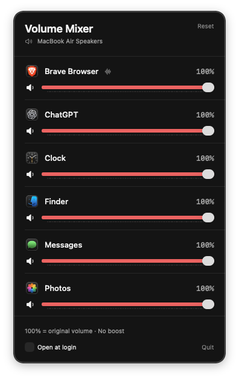

# Volume Mixer

A simple macOS menu-bar app for controlling the volume of individual open apps. Turn down your browser or music without changing your Mac's master volume.

**Every app starts at 100%. No amplification, equalizer, or audio driver.**

<p align="center">
  
</p>

## Features

- **Menu-bar controls:** click the three-slider icon to open the mixer.
- **Open apps only:** the list updates as apps launch and quit, with icons and audio activity indicators.
- **Individual volume sliders:** adjust each app from 0% to 100%, with the percentage shown beside its name.
- **Original audio at 100%:** the app's audio passes through normally, without capture or replay. Audio processing starts only when you reduce its volume.
- **Perceptual volume curve:** a cubic taper gives more control over quieter levels, consistently across output devices. Percentages show slider position, not raw amplitude or a measured loudness percentage.
- **No amplification:** gain is limited to the original signal level. 100% remains untouched audio and 0% remains mute.
- **One-click mute:** mute an app or restore it to 100% using its speaker button.
- **Reset all:** return every app to its original volume immediately.
- **Fresh defaults:** newly opened apps start at 100%. Volume settings are not saved between mixer launches.
- **Helper grouping:** browser and Electron audio helpers are grouped under their parent app.
- **Output awareness:** the mixer follows the default output device and rebuilds active audio routes when it changes.
- **Optional launch at login:** enable it directly in the mixer.
- **Local processing:** audio stays in memory on your Mac. The app does not save recordings or send audio over the network.
- **Simple removal:** quit and delete the app; there is no persistent driver or background service to uninstall.

## Requirements

- macOS **14.4 or later**.
- Swift **6** command-line tools to build from source.
- A supported mono or stereo output device.
- System audio capture permission when first reducing an app's volume.

This is an early release. It builds successfully, but end-to-end audio compatibility has not been fully verified. FaceTime support is experimental; see [known limitations](docs/usage.md#known-limitations).

## Build and install

```sh
git clone https://github.com/janny801/volume-mixer.git
cd volume-mixer
./scripts/build.sh
```

The build creates `dist/Volume Mixer.app`. Copy it to **Applications**, then open it and click the three-slider menu-bar icon.

For a quick run from the build folder:

```sh
open "dist/Volume Mixer.app"
```

The build is ad-hoc signed for local use, not Developer ID signed or notarized. A rebuild may cause macOS to ask for audio permission again. Use the Applications copy for **Open at login**.

## Using the mixer

1. Open an app and start playing audio.
2. Click **Volume Mixer** in the menu bar.
3. Lower that app's slider. Grant macOS system audio capture permission if prompted.
4. Return it to **100%**, or click **Reset**, to restore original audio.

At 100%, launching or quitting the mixer does not change that app's signal. Quitting while an app is turned down restores its original volume.

## How the volume slider works

The slider uses a **perceptual cubic curve** instead of directly scaling audio by
the displayed percentage. This gives quieter levels more slider travel and aims
to feel closer to a conventional volume control. The curve stays consistent
across speakers and headphones; it does **not** exactly reproduce a particular
macOS output device's volume mapping.

| Slider | Signal amplitude | Behavior |
| --- | --- | --- |
| 100% | Original signal | Completely bypasses audio processing |
| 75% | About 42% | Attenuates by about 7.5 dB |
| 50% | 12.5% | Attenuates by about 18 dB |
| 25% | About 1.6% | Attenuates by about 36 dB |
| 0% | Zero | Mutes the app |

The calculation is `gain = (slider percentage / 100)³`. Percentages describe the
slider position, not measured perceived loudness. Changes are briefly smoothed
to reduce clicks. **There is no amplification**, and your Mac's master volume
still applies separately.

## Documentation

- [Usage, permissions, troubleshooting, and removal](docs/usage.md)
- [Architecture, building, and contributing](docs/development.md)

## License

[MIT](LICENSE) — Copyright © 2026 Janred Salubayba.
